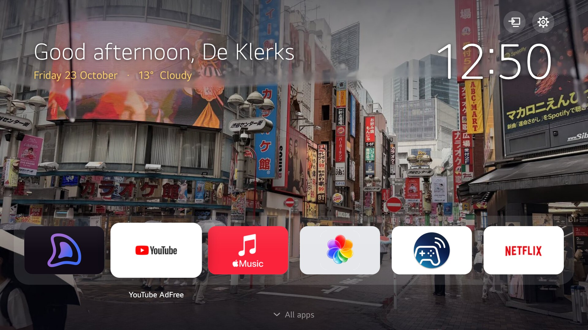

# PearWebOS

An Apple TV style Home for LG webOS TVs. Not an Apple, but close: a pear.



- **A calm welcome.** "Good evening" with your name, the date and a big clock, over a photo of yours that changes each time you turn the TV on.
- **Six apps in a glass dock, the rest one press down.** Big tiles that lift when focused, with the name underneath. The order is yours: hold OK on any tile to rearrange.
- **Straight to Home.** Power on, close an app, or wake from the screensaver and you land on Home, not on LG's "Today" wallpapers or an untuned Live TV.
- **Quiet.** LG's ads, promos and AI nudges never appear, because Pear draws its own Home.

PearWebOS changes nothing on the TV's system partition. It mounts three files over LG Home's own while it runs; `./pear off` or `./pear uninstall` puts LG's Home straight back.

## What you need

- An LG TV on **webOS 6** (2021 models), **rooted** with [Homebrew Channel](https://www.webosbrew.org/), and **SSH turned on** in Homebrew Channel's settings. See [Tested on](#tested-on). Other webOS 6 models should work. On a firmware whose Home differs, setup stops before installing anything.
- A Mac or Linux computer on the same network, with Python 3 and two libraries:
  ```bash
  python3 -m pip install --user pillow numpy
  ```

## Tested on

| TV | webOS | Firmware | Works |
|---|---|---|---|
| LG 65NANO886PB (2021 NanoCell) | 6.4.0 | 03.41.05 | Yes |
| LG OLED65A1PTA (2021 OLED) | 6.5.0 | 03.51.16 | Yes |
| LG 86UP80009LA (2021 UHD) | 6.5.3 | 03.53.45 | Yes |

Tried it on another TV? Please [open an issue](https://github.com/Arnedeklerk/PearWebOS/issues/new) with the model, webOS version and firmware (Settings → General → About This TV), and whether it worked, so this table can grow.

## Install

```bash
git clone https://github.com/Arnedeklerk/PearWebOS.git
cd PearWebOS
ssh-copy-id root@<your-tv-ip>    # once; Homebrew Channel's default password is alpine
./pear setup
```

`./pear setup` finds the TV on your network and asks a few questions: the name for the greeting, a 12 or 24 hour clock, whether you watch Live TV through an aerial, and three power-on choices. Then it installs. It takes about a minute.

## Your photos

Put photos in `photos/` and run `./pear sync`. Each one is cropped to 16:9 at 1600×900 and gets a date colour picked from the photo itself. One is chosen at random whenever Home comes back after 15 minutes away. Your photos never leave your machine and your TV: the folder is ignored by git. Until you add your own, Pear comes with one to start: a rainy evening in Shibuya. To nudge a crop or a colour, see [photos/README.md](photos/README.md).

## Using it

| Remote | On Home |
|---|---|
| ← → | move along the dock |
| ↓ | open the drawer of all apps |
| ↑ / Back | back to the dock |
| OK | open the app |
| hold OK | LG's Edit App List, to reorder or remove apps |

LG's promo apps (LG Channels, Shop Time, Sports Alert and the like) are left off the tiles. The list is `hiddenApps` in [qml/PearHome.qml](qml/PearHome.qml).

## Commands

```
./pear setup       find the TV, ask, install
./pear sync        rebuild and push after changing photos or settings
./pear status      what is mounted and running
./pear on | off    Pear Home, or LG's own
./pear shot        screenshot the TV to docs/screenshot.jpg
./pear uninstall   remove PearWebOS from the TV
```

## How it works

LG Home is written in QML. Pear's own Home is [qml/PearHome.qml](qml/PearHome.qml). It is loaded on top of LG's, which stays running underneath, so launching apps, the app order and Edit App List are still LG's own.

**LG's files stay on your TV.** LG Home is proprietary, so this repository contains none of it. Setup copies the three LG files it needs off your TV, applies [small exact edits](installer/patch_home.py) on your computer, and sends the results back. Each edit must match exactly once, so a firmware that differs fails safely before anything is installed.

On the TV everything lives in `/var/lib/pearwebos`, and a Homebrew Channel startup hook re-applies it at each boot:

- [`pearwebos`](tv/pearwebos) mounts the files and restarts Home. LG Home is restored from memory snapshots with its QML preloaded, so it has to be cold-started to pick Pear up.
- [`homeguard`](tv/homeguard) watches what is on screen and opens Home when the TV would otherwise sit on an empty Live TV. It is off if you said you watch Live TV.
- [`luna-send-n`](tv/luna-send-n) works around webOS 6.4 firmware whose `luna-send -n` prints nothing.

## Good to know

- **Firmware updates.** An LG update can remove root, and Pear with it. Setup can hide LG's "update now?" prompt. If it ever appears anyway, answer No unless you mean it.
- **A full reboot**, such as after a power cut, starts with LG's stock Home for a moment before Pear takes over. With Quick Start+ on, ordinary power-ons resume straight into Pear.
- **If Pear's Home fails to load**, LG's Home shows instead, with the reason in small text in the bottom-left corner.

## Pairs well with

- [lg-lockout](https://github.com/HunterAP23/lg-lockout): blocks LG's telemetry, ads and ACR on a rooted TV.
- [webos-debloat](https://gist.github.com/lucataco/7c303b443934008a9031a55cfca552ec): stops LG preloading apps you don't use, which frees memory.

## License

MIT; see [LICENSE](LICENSE). PearWebOS is not affiliated with LG Electronics or Apple. webOS is a trademark of LG Electronics; Apple TV is a trademark of Apple Inc. Rooting your TV may void its warranty; use at your own risk.
