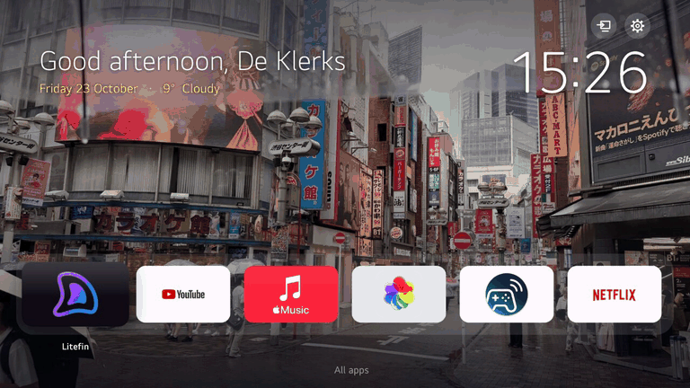

<h1 align="center">PearWebOS</h1>

<p align="center">
  An Apple TV style Home for LG webOS TVs.<br>
  <sub>Not an Apple, but close: a pear.</sub>
</p>

<p align="center">
  <a href="https://github.com/Arnedeklerk/PearWebOS/releases/latest"></a>
  <a href="https://github.com/Arnedeklerk/PearWebOS/actions/workflows/check.yml"></a>
  <a href="LICENSE"></a>
</p>

<p align="center"></p>

- **A calm welcome.** Your name, the date, a big clock and the weather, over your own photos.
- **Six apps in a glass dock.** Every other app is one press down.
- **Inputs and Settings, top right.** Switch inputs or change Pear right on the TV.
- **Straight to Home.** No "Today" wallpapers, no empty Live TV, no ads.
- **Nothing permanent.** Pear changes nothing on the TV's system; one command puts LG's Home back.

## Get it

You need a **rooted LG TV** ([Homebrew Channel](https://www.webosbrew.org/) with SSH turned on) and a computer with Python 3. Pear is made for **webOS 6** (2021 TVs). On newer TVs, webOS 10 included, it installs as an app of its own: that's new, so [tell us how it goes](https://github.com/Arnedeklerk/PearWebOS/issues/9). [Which TVs it's been tried on](docs/GUIDE.md#tested-on).

```bash
git clone https://github.com/Arnedeklerk/PearWebOS.git && cd PearWebOS
python3 -m pip install --user pillow numpy
ssh-copy-id root@<your-tv-ip>    # once; Homebrew Channel's password is alpine
./pear setup
```

Setup finds your TV, asks a few questions and installs, in about a minute. On Windows or Android, see [the guide](docs/GUIDE.md#install).

## Use it

| Remote | |
|---|---|
| ← → | move along the dock |
| ↓ | all your apps |
| ↑ | Inputs and Settings |
| OK | open |
| hold OK | rearrange your apps |

Add your photos to `photos/`, then run `./pear photos`. To get the latest Pear, pick **Update Pear** in Settings on the TV, or run `./pear update`.

## More

- **[The guide](docs/GUIDE.md)**: every setting, the commands, how it works, and good to know.
- **[Tested on](docs/GUIDE.md#tested-on)**: the TVs it's known to work on. Tried another? [Tell us](https://github.com/Arnedeklerk/PearWebOS/issues/new).

<sub>MIT licensed. Not affiliated with LG Electronics or Apple. Rooting your TV may void its warranty; use at your own risk.</sub>
